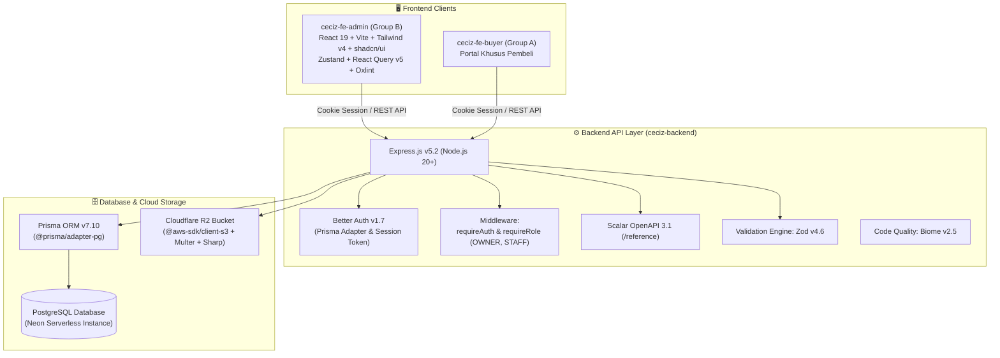
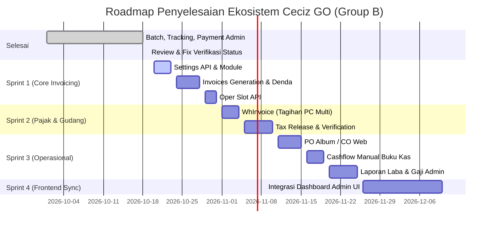

# 📋 Laporan Status Sistem (As-Is) & Panduan Pembaruan PRD v1.4
## Ekosistem Ceciz GO — Modul Admin Side & Calculation Engine (Group B)

Dokumen ini disusun sebagai acuan komprehensif untuk menyelaraskan kondisi teknis aktual pada *codebase* (`ceciz-backend` & `ceciz-fe-admin`) dengan spesifikasi bisnis pada **`[v1.3] PRD_Group_B_Admin_Side.docx`**. Laporan ini ditujukan sebagai dasar utama dalam penyusunan dan pembaruan dokumen **PRD v1.4**.

---

## 1. Ringkasan Eksekutif (*Executive Summary*)

**Group B** bertanggung jawab penuh atas modul **Admin Side & Calculation Engine** pada ekosistem Ceciz GO. Sistem ini mengotomasi perhitungan harga merchandise K-Pop/J-Pop lintas 5 negara (`CH`, `KR`, `TH`, `JP`, `INA`), mengelola alur logistik internasional 7 tahap, menangani verifikasi bukti pembayaran, merilis tagihan pajak periodik multi-batch, mengelola PO album DP+FP, mencatat arus kas manual (*cashflow*), serta memfasilitasi pelaporan laba dan gaji admin.

### Matriks Kesiapan Sistem Saat Ini

| Komponen | Status Aktual | Keterangan |
| :--- | :--- | :--- |
| **Backend Framework & Core** | **100% Siap** | Express 5.2, TypeScript Strict, modular routes/controllers/schemas. |
| **Database & Schema ORM** | **95% Siap** | Prisma 7.10 dengan 15 Model & 12 Enum termigrasi di PostgreSQL (Neon). |
| **Autentikasi & Otorisasi** | **85% Siap** | Better Auth 1.7 aktif; RBAC Role (`OWNER`, `STAFF`, `BUYER`) aktif. Granular module permission per-staff perlu diselaraskan. |
| **API Endpoints (Admin Side)** | **~35% Selesai (16 Endpoint)** | Batch, Tracking, Payment Verification, dan Upload Cloudflare R2 telah *live*. |
| **Calculation Engine Service** | **50% Selesai** | Schema field kalkulasi sudah ada; kalkulasi otomatis formula 5 negara perlu diisolasi ke dedicated service/utility. |
| **Frontend Admin (`ceciz-fe-admin`)** | **15% (Inisialisasi)** | Setup Vite, React 19, Tailwind CSS v4, shadcn/ui, React Query, Zustand telah siap. UI modul masih tahap boilerplate. |

---

## 2. Kondisi Menyeluruh Tech Stack & Infrastruktur (*Technical Blueprint*)

Arsitektur teknologi telah disesuaikan dengan Bab 10 PRD v1.3 dengan implementasi nyata pada repo sebagai berikut:



### 2.1 Rincian Tech Stack Backend (`ceciz-backend`)
* **Runtime & Framework**: Node.js (v20+ LTS) dengan **Express.js v5.2.1** (routing native promise handling).
* **Database ORM**: **Prisma ORM v7.10.0** menggunakan driver adapter `@prisma/adapter-pg` dan `pg v8.23.0` yang terhubung ke **PostgreSQL Serverless (Neon)**. Client di-generate ke `src/generated/prisma`.
* **Autentikasi**: **Better Auth v1.7.5** (menggunakan Prisma Adapter, cookie session `better-auth.session_token`, mounted di `/api/auth/*splat`).
* **Storage & Image Processing**: **Cloudflare R2** via `@aws-sdk/client-s3 v3.1146.0`, dipadukan dengan **Multer v2.4** (memory storage) dan **Sharp v0.35.5** untuk kompresi gambar bukti bayar.
* **Validasi Skema**: **Zod v4.6.5** untuk validasi ketat request body, params, dan query string.
* **Dokumentasi Interaktif**: **Scalar** (`@scalar/express-api-reference v0.10.30`) menyajikan OpenAPI 3.1 secara interaktif di `/reference` dan JSON mentah di `/openapi.json`.
* **Code Tooling**: **Biome v2.5.14** sebagai unified linter & formatter super cepat.
* **Package Manager**: **pnpm v10.33.0** (strict mode).

### 2.2 Rincian Tech Stack Frontend Admin (`ceciz-fe-admin`)
* **Framework & Bundler**: **React 19** & **Vite** (TypeScript strict mode).
* **Styling**: **Tailwind CSS v4** (`@tailwindcss/vite`) dengan utility `tw-animate-css`.
* **Komponen UI**: **shadcn/ui** (`radix-nova` style) berbasis **Radix UI** primitives.
* **Ikonografi & Tipografi**: **Lucide React** dan **Geist Font**.
* **Manajemen State**: **Zustand** (global client state) dan **TanStack React Query v5** (server state, caching, & refetching).
* **Form & Validasi**: **React Hook Form** terintegrasi dengan **Zod resolver**.
* **Routing**: **React Router v8**.
* **Linter**: **Oxlint** untuk analisis statis ultra-cepat.

---

## 3. Pemetaan Fitur PRD v1.3 vs Kondisi *Codebase* Aktual

Berikut adalah audit keselarasan antara setiap bab pada PRD v1.3 dengan implementasi kode saat ini:

| Bagian PRD v1.3 | Ruang Lingkup PRD | Status Codebase (*As-Is*) | Gap / Tindak Lanjut (*To-Be*) |
| :--- | :--- | :--- | :--- |
| **§6.1 Batch & Calculation Engine** | • 5 Negara (CH, KR, TH, JP, INA)<br/>• Row dinamis (1 row = 1 pcs = 1 buyer)<br/>• `buyer_id` wajib di semua negara<br/>• Khusus JP: `harga_jual_per_buyer`<br/>• Fee Rekap Tiered basis total batch<br/>• Oper Slot / Reassign buyer | • Model `Batch` & `BatchItem` sudah ada di Prisma.<br/>• CRUD batch dasar selesai (`/api/v1/admin/batches`).<br/>• Foreign key `buyerId` sudah wajib.<br/>• Field `jpHargaJual` sudah ada di schema. | • Perlu modul *Calculation Engine* terpisah untuk mengeksekusi rumus CH/TH/KR/JP/INA secara realtime.<br/>• Endpoint khusus **Oper Slot** (`PATCH /api/v1/admin/batches/:id/reassign-slot`) belum dibuat.<br/>• Rumus fee rekap bertingkat belum membaca tabel JSON dari `Setting`. |
| **§6.2 Verifikasi Pembayaran** | • Dashboard antrian bukti bayar<br/>• Approve / Reject (satuan & massal)<br/>• Alasan penolakan (`rejectReason`)<br/>• Rekap pembayaran bulanan & denda | • **100% Selesai** di Backend.<br/>• Endpoint stats, list, getById, verify, bulk-verify, dan manual payment sudah aktif.<br/>• Reversal status invoice otomatis jika ditolak. | • Integrasi antarmuka pada `ceciz-fe-admin`. |
| **§6.3 Tagihan PC Multi-Batch** | • Input tagihan WH luar negeri<br/>• Multi-select `covered_batch_ids`<br/>• Distribusi proporsional (`pcs_batch / total_pcs`) | • Model `WhInvoice` sudah ada di Prisma (`whInvoiceTotal`, `coveredBatchIds`, `allocationRatio`, `allocatedAmount`). | • Controller dan route untuk `WhInvoice` belum dibuat (`/api/v1/admin/taxes/wh-invoices`).<br/>• Logika otomatis inject hasil alokasi ke kolom `tagihan_pc` batch belum ada. |
| **§6.4 Tracking Barang (7 Tahap)** | • 7 Tahap tracking enum<br/>• Input multi-resi (array string)<br/>• Checklist `checked_out` (admin-only)<br/>• Checklist `uploaded_to_album`<br/>• Otomatis arsip saat `Done` | • **100% Selesai** di Backend.<br/>• Model `Tracking` & Enum `TrackingStatus` lengkap.<br/>• Endpoint list, get by batchId, dan patch tracking sudah aktif. | • UI dashboard tracking pada frontend admin. |
| **§6.5 Tagihan Tax Periodik Multi-Batch** | • Release periodik multi-batch<br/>• Scan item belum ditagih tax per buyer<br/>• Rate tax dari Settings (PC vs Non-PC)<br/>• Deadline & `max_checkout_date` per invoice<br/>• Verifikasi bukti bayar pajak | • Model `TaxInvoice` dan `TaxPayment` sudah lengkap di Prisma. | • Endpoint rilis pajak (`POST /api/v1/admin/taxes/releases`) belum dibuat.<br/>• Endpoint verifikasi bukti bayar pajak (`PATCH /api/v1/admin/taxes/payments/:id/verify`) belum dibuat. |
| **§6.6 Laporan Keuangan** | • Laba GO per batch (kotor & bersih)<br/>• Rekap laba per periode & bagi hasil admin<br/>• Gaji admin (nyelem + rekap)<br/>• Checkbox `DONE LABA`<br/>• Export XLSX / PDF | • Kolom `hargaTotal`, `hargaTfSeller`, `selisihHarga`, `labaBersih` sudah ada di model `Batch`. | • Belum ada endpoint agregasi laporan laba (`/api/v1/admin/reports/profit`).<br/>• Belum ada endpoint agregasi gaji admin (`/api/v1/admin/reports/payroll`).<br/>• Fitur export XLSX/PDF belum diimplementasikan. |
| **§6.7 PO Album / CO Web** | • Skema DP + FP (nominal & metode beda)<br/>• Status tracking 7 tahap<br/>• Admin-only input | • Model `PoAlbum` sudah ada di Prisma (`dpAmount`, `dpMethod`, `fpAmount`, `fpMethod`, `trackingStatus`). | • Belum ada controller dan route CRUD PO Album (`/api/v1/admin/po-albums`). |
| **§6.8 Cashflow Manual (Buku Kas)** | • Input transaksi pemasukan/pengeluaran<br/>• Kategori operasional & metode bayar<br/>• Dashboard saldo kas | • Model `CashflowEntry` sudah ada di Prisma (`entryDate`, `amount`, `type`, `category`, `paymentMethod`). | • Belum ada controller dan route Cashflow (`/api/v1/admin/cashflow`). |
| **§6.9 Pengaturan (Settings)** | • Kurs harian, fee default, denda harian<br/>• Deadline jam bayar batch & tax<br/>• Rate tax PC & Non-PC<br/>• Tabel tiered fee rekap (JSON) | • Model `Setting` (singleton id: `singleton`) sudah ada di Prisma. | • Belum ada controller dan route Settings (`GET/PATCH /api/v1/admin/settings`). |
| **§6.10 Roles & Permission** | • RBAC Owner vs Staff Operasional<br/>• Toggle permission modul per akun staff | • Enum `Role` (`OWNER`, `STAFF`, `BUYER`) aktif di Better Auth & middleware `requireRole`. | • Field JSON/relasi `module_permissions` per user belum ada di model `User`. Saat ini role masih statis. |

---

## 4. Rincian Endpoint API yang Telah Selesai (16 Endpoint)

Seluruh endpoint berikut berada dalam status **Production-Ready** di `ceciz-backend`:

```
POST   /api/auth/sign-in/email             -> Login Better Auth
GET    /api/auth/get-session               -> Cek session aktif
POST   /api/auth/sign-out                  -> Logout sesi
POST   /api/v1/upload                      -> Upload file ke Cloudflare R2

GET    /api/v1/admin/batches/stats         -> 4 Kartu Metrik Batch
POST   /api/v1/admin/batches               -> Buat Batch baru + BatchItem[]
GET    /api/v1/admin/batches               -> Daftar Batch (filter & paginasi)
GET    /api/v1/admin/batches/:id           -> Detail Batch
PATCH  /api/v1/admin/batches/:id           -> Update Batch
DELETE /api/v1/admin/batches/:id           -> Hapus Batch

GET    /api/v1/admin/tracking              -> Daftar Logistik Semua Batch
GET    /api/v1/admin/tracking/:batchId     -> Detail Logistik Batch
PATCH  /api/v1/admin/tracking/:batchId     -> Update 7 Tahap, Resi, & Checklist CO

GET    /api/v1/admin/payments/stats        -> Statistik Verifikasi Pembayaran
GET    /api/v1/admin/payments              -> List Bukti Bayar (Tab, Search Nominal IDR)
GET    /api/v1/admin/payments/:id          -> Detail Bukti Bayar
PATCH  /api/v1/admin/payments/:id/verify   -> Approve/Reject + Auto Penyesuaian Invoice
POST   /api/v1/admin/payments/bulk-verify  -> Verifikasi Massal Bukti Bayar
POST   /api/v1/admin/payments              -> Catat Pembayaran Manual Admin (+ Validasi Buyer)
```

---

## 5. Rincian Spesifikasi Endpoint yang Perlu Dibangun (*Pending Scope*)

Untuk melengkapi PRD v1.4, berikut adalah rincian API kontrak yang perlu dijadwalkan:

### 5.1 Modul Invoice Admin (`Invoice`)
* `POST /api/v1/admin/invoices/generate`: Meng-generate invoice untuk seluruh buyer dalam suatu batch berdasarkan kalkulasi harga per buyer + fee GO + fee rekap tier.
* `GET /api/v1/admin/invoices`: List invoice dengan filter status (`UNPAID`, `AWAITING_VERIFICATION`, `PAID`, `OVERDUE`).
* `GET /api/v1/admin/invoices/:id`: Detail tagihan, rincian item JSON, dan akumulasi denda berjalan.
* `PATCH /api/v1/admin/invoices/:id/waive-penalty`: Menghapus denda dengan alasan (*mandatory reason*) yang dicatat pada audit log.

### 5.2 Modul Tagihan PC Multi-Batch (`WhInvoice`)
* `POST /api/v1/admin/wh-invoices`: Input total tagihan warehouse dan array `coveredBatchIds`. Backend otomatis menghitung `allocationRatio` dan mendistribusikan nominal ke kolom `tagihan_pc` tiap batch terkait.
* `GET /api/v1/admin/wh-invoices`: Riwayat tagihan warehouse luar negeri.

### 5.3 Modul Tagihan Tax Periodik Multi-Batch (`TaxInvoice` & `TaxPayment`)
* `GET /api/v1/admin/taxes/preview`: Preview semua pesanan yang telah berstatus `ARRIVED_WH_INA` namun belum diterbitkan tagihan pajaknya.
* `POST /api/v1/admin/taxes/releases`: Menerbitkan `TaxInvoice` secara periodik multi-batch per buyer dengan deadline spesifik per invoice.
* `GET /api/v1/admin/taxes/invoices`: Daftar tagihan invoice pajak per pembeli.
* `GET /api/v1/admin/taxes/payments`: Antrian bukti bayar pajak untuk verifikasi admin.
* `PATCH /api/v1/admin/taxes/payments/:id/verify`: Approve/Reject pembayaran pajak.

### 5.4 Modul PO Album / CO Web (`PoAlbum`)
* `GET /api/v1/admin/po-albums`: Daftar monitoring pesanan PO album (filter status DP/FP, tracking).
* `POST /api/v1/admin/po-albums`: Tambah pesanan album fisik skema DP+FP.
* `PATCH /api/v1/admin/po-albums/:id`: Update pembayaran FP atau update tracking status ke `BISA_DI_CO`.
* `DELETE /api/v1/admin/po-albums/:id`: Hapus rekapan PO album.

### 5.5 Modul Cashflow Manual (`CashflowEntry`)
* `GET /api/v1/admin/cashflow`: Riwayat arus kas dengan filter rentang tanggal, kategori, dan tipe (`INCOME`/`EXPENSE`).
* `GET /api/v1/admin/cashflow/stats`: Ringkasan total uang masuk, uang keluar, dan saldo kas bersih.
* `POST /api/v1/admin/cashflow`: Mencatat transaksi kas masuk/keluar baru.
* `PATCH /api/v1/admin/cashflow/:id` & `DELETE /api/v1/admin/cashflow/:id`: Edit dan hapus catatan kas.

### 5.6 Modul Laporan Keuangan & Gaji Admin
* `GET /api/v1/admin/reports/profit`: Laba kotor dan laba bersih per batch / per negara / per periode bulan.
* `GET /api/v1/admin/reports/payroll`: Akumulasi fee nyelem + fee rekap per admin per periode.
* `PATCH /api/v1/admin/batches/:id/done-laba`: Menandai batch telah selesai perhitungan laba (`done_laba = true`).
* `GET /api/v1/admin/reports/export`: Ekspor data ke format XLSX dan PDF.

### 5.7 Modul Pengaturan Global (`Setting`)
* `GET /api/v1/admin/settings`: Mengambil nilai parameter singleton (kurs hari ini, tier fee rekap, tarif tax PC/Non-PC, deadline hours).
* `PATCH /api/v1/admin/settings`: Memperbarui konfigurasi perhitungan harga.

---

## 6. Gap Kritis & Rekomendasi Pembaruan PRD v1.4

Terdapat beberapa poin ketidaksesuaian (*mismatch*) antara PRD v1.3 dan arsitektur database aktual yang **wajib disempurnakan pada PRD v1.4**:

### 6.1 Granular Permissions pada Role Staff (§6.10)
* **Temuan**: PRD v1.3 menyatakan bahwa Owner dapat mengaktifkan/menonaktifkan modul tertentu per staff (misal: staff A hanya tracking & upnote, staff B hanya packing). Namun di `schema.prisma`, tabel `User` hanya memiliki kolom `role: Role` (`OWNER`, `STAFF`, `BUYER`) tanpa kolom permission granular.
* **Rekomendasi PRD v1.4**: Tambahkan kolom `modulePermissions Json?` pada model `User` di Prisma, misalnya:
  ```json
  { "canTracking": true, "canUpnote": true, "canUploadAlbum": false }
  ```

### 6.2 Audit Trail / Activity Log (§8 & §11)
* **Temuan**: PRD v1.3 mensyaratkan setiap aksi *waive denda*, *oper slot*, dan penghapusan transaksi tercatat dalam *Activity Log* yang tidak dapat dihapus. Di schema saat ini, belum ada tabel `AuditLog`.
* **Rekomendasi PRD v1.4**: Definisikan model `AuditLog` di Prisma schema:
  ```prisma
  model AuditLog {
    id        String   @id @default(cuid())
    userId    String
    action    String   // WAIVE_PENALTY, OPER_SLOT, DELETE_CASHFLOW
    targetId  String
    reason    String?
    metadata  Json?
    createdAt DateTime @default(now())
  }
  ```

### 6.3 Lokasi Eksekusi Calculation Engine (§10 vs §7)
* **Temuan**: Pada tabel Tech Stack PRD v1.3 baris 625 tertulis: *"Calculation Logic: Pure TypeScript functions (client-side)"*.
* **Evaluasi Teknis**: Menjalankan kalkulasi murni di client-side berisiko manipulasi harga saat request dikirim ke backend. 
* **Rekomendasi PRD v1.4**: Tegaskan arsitektur **Dual-Layer Calculation Engine**:
  * *Client-side (Frontend)*: Menghitung preview secara reaktif (< 1 detik) di UI saat form diisi.
  * *Server-side (Backend)*: Menghitung ulang dan memvalidasi kebenaran angka sebelum data disimpan ke database.

### 6.4 Mekanisme Penghitungan Denda Berjalan (§8)
* **Temuan**: Denda Rp 2.000/hari berjalan dari deadline hingga bukti bayar diverifikasi.
* **Rekomendasi PRD v1.4**: Tetapkan bahwa nominal denda dihitung secara dinamis (*virtual computed field*) saat API invoice diakses:
  $$\text{Hari Terlambat} = \max\left(0, \left\lfloor\frac{\text{Waktu Verifikasi / Sekarang} - \text{Deadline}}{24\text{ jam}}\right\rfloor\right)$$
  $$\text{Denda Total} = \text{Hari Terlambat} \times \text{Penalty Per Day}$$
  Hal ini menghindari kebutuhan cron job berat yang harus mengupdate ribuan baris setiap pergantian hari.

---

## 7. Rencana Tahapan Rilis (*Sprint Plan Roadmap*)


